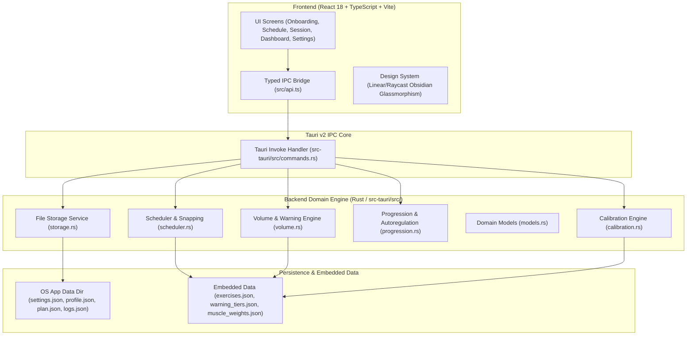
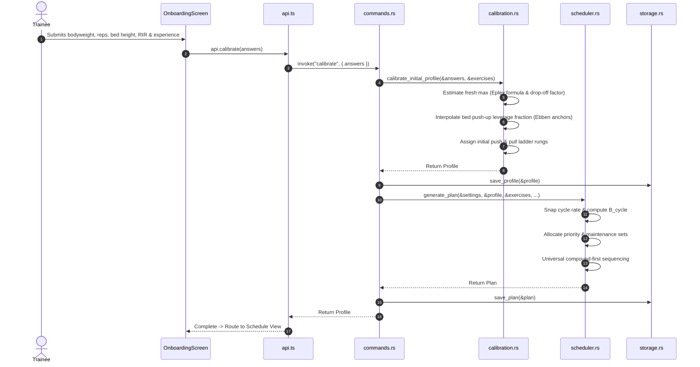
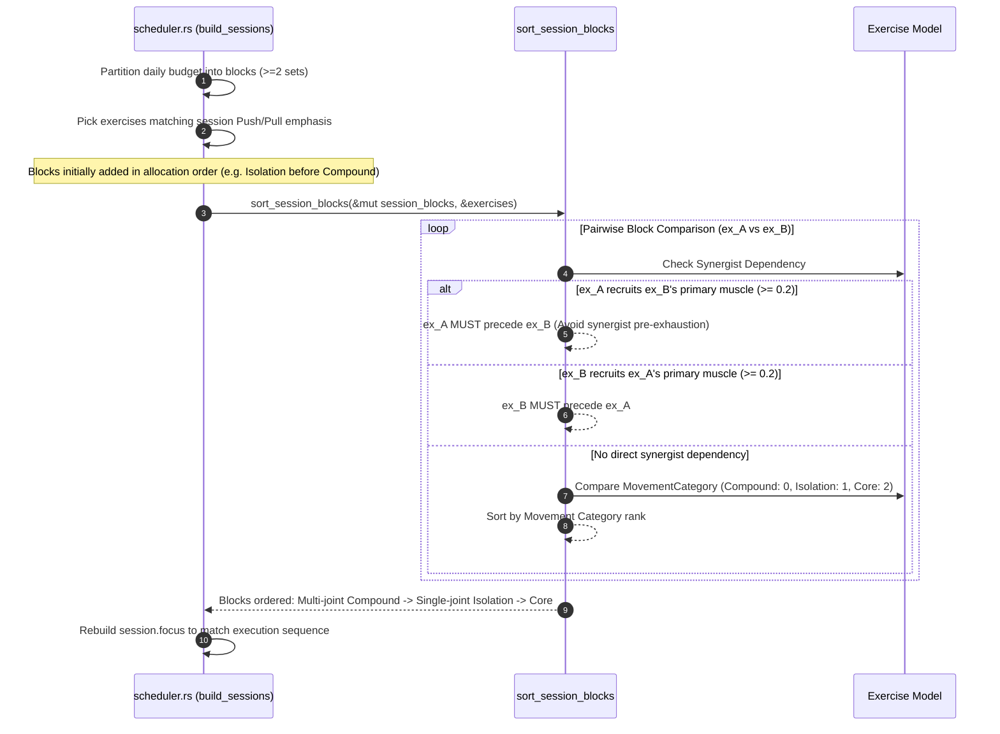

# Muscle Growth Planner — Technical Architecture & Codebase Guide

This document outlines the complete architectural design, domain logic, data models, and component interactions of the **Muscle Growth Planner** codebase. It is written to provide any AI agent or engineer a thorough understanding of the application's design principles, algorithms, and implementation details.

---

## 1. System Overview & Core Philosophy

The Muscle Growth Planner is a cross-platform desktop application built using **Tauri v2** (Rust backend + React 18 / TypeScript frontend). It functions as an evidence-grounded hypertrophy training architect designed around bodyweight, minimal equipment (bed, pull-up bar, parallettes, backpack), and a fixed 15 kg dumbbell.

### Core Scientific & Engineering Invariants
1. **Strict Volume Invariance (§8)**: The app never modifies set counts on its own. Total weekly sets and sets per session remain strictly invariant to what the trainee configured in settings, unless an explicit lighter cycle (deload) is triggered.
2. **Hard Sets Proximity (§5.1)**: Only sets performed within **0–3 Reps in Reserve (RIR)** count as effective volume. Sets ending $\ge 4$ RIR do not count toward effective hypertrophy stimulus.
3. **Double Progression Sequence (§8)**: Progression within a fixed set budget follows a strict sequence:
   $$\text{Reps to target ceiling} \longrightarrow \text{Execution Intensifiers (tempo/pause/lengthened partials)} \longrightarrow \text{Harder Variation (ladder rung)} \longrightarrow \text{Backpack Load (1.5L bottles)}$$
4. **Universal Exercise Sequencing (§6.4)**: Exercises within each session are automatically sequenced according to biomechanics:
   $$\text{Multi-joint Compounds (Torso)} \longrightarrow \text{Single-joint Isolations (Limbs)} \longrightarrow \text{Core / Stabilizers (Abs)}$$
   *Synergist Dependency Rule*: If Exercise $A$ relies on Exercise $B$'s primary muscle as a secondary mover (e.g. Push-up uses Triceps), Exercise $A$ **must always precede** Exercise $B$ to prevent premature synergist failure from starving the primary mover of mechanical tension.
5. **Transparent Heuristic Boundaries (§5.3, §9)**: The engine openly differentiates between strong scientific consensus (dose-response volume, failure proximity, stretch-mediated hypertrophy) and heuristic approximations (bed height push-up leverage interpolation, 48h recovery gaps, 8 sets/session ceilings, beginner ~30% volume scaling).

---

## 2. High-Level Architecture



---

## 3. Backend Module Breakdown (`src-tauri/src/`)

### 3.1 `models.rs` — Domain Type System
Defines all primary data structures, enums, serialization aliases, and business models:

- `Muscle`: Enum (`Chest`, `Back`, `Biceps`, `Triceps`, `Forearms`, `Abs`). Provides `as_str()` and `ALL` constant.
- `Units`: Enum (`Metric`, `Imperial`).
- `ExperienceLevel`: Enum (`Under6Months`, `SixTo24Months`, `Over2Years`). Uses Serde aliases (`under_6_months` / `under6_months`) to guarantee resilient frontend serialization.
- `MovementCategory`: Enum (`Compound = 0`, `Isolation = 1`, `Core = 2`). Implements `PartialOrd`/`Ord` to dictate intra-session exercise ordering.
- `MuscleWeights`: Direct and indirect contribution matrix with `get(muscle)` and `set(muscle, val)`.
- `Exercise`: Complete movement schema:
  - Identification: `id`, `name`, `primary_muscle`, `contribution_weights`.
  - Progression: `ladder`, `rung`, `easier_id`, `harder_id`.
  - Biomechanics: `bw_fraction`, `bw_anchors` (height-to-fraction map), `time_based`, `stretched_position`, `cues`.
  - Helpers: `movement_category(&self) -> MovementCategory`.
- `Settings`: User training preferences (`units`, `backpack`, `bed_height_cm`, `priority_muscles`, `maintenance_on`, `experience`, `sets_per_day`, `days_per_week`, `calendar_view`).
- `Profile`: Trainee strength baselines (`estimated_max_reps: HashMap<String, u32>`, `dumbbell_calibrated_reps: Option<u32>`).
- `Cycle`: Rolling frequency schedule (`length_days`, `sessions_count`, `effective_weekly_rate`, `description`, `is_adjusted`, `adjusted_message`).
- `Block`: Scheduled workout block (`exercise_id`, `sets`, `rep_target_min/max`, `seconds_target_min/max`, `effort_target`, `tempo_cue`, `rest_cue`, `added_weight_kg`).
- `Session`: Session queue element (`session_number`, `focus: Vec<Muscle>`, `blocks: Vec<Block>`).
- `Plan`: The generated training plan (`cycle`, `sessions`, `maintenance_deficits`, `cumulative_effective_sets`, `maintenance_dropped`).
- `SetLog`: Execution logger entry (`timestamp`, `session_number`, `block_index`, `exercise_id`, `reps_or_seconds`, `added_weight_kg`, `reps_from_failure`).
- `ProgressionSuggestion`: Autoregulated progression recommendations.
- `Warning`: System diagnostic (`code`, `severity`, `message`, `lower_evidence`).
- `WarningTier` & `WarningTiersData`: Scientific dose-response volume thresholds.

### 3.2 `calibration.rs` — Baseline Strength & Leverage Math
Handles calibration from onboarding test sets:

1. **Epley 1RM & Rep Estimation**:
   $$\text{1RM} = \text{weight} \times \left(1 + \frac{\text{reps}}{30}\right)$$
   $$\text{reps at new load} = \text{round}\left(30 \times \left(\frac{\text{1RM}}{\text{new load}} - 1\right)\right)$$
2. **Fresh Max Reps from 4-Set Averages (v1.4 Scientific Engine)**:
   Trainees provide their average reps across 4 hard sets:
   - Sets marked *close to failure* (0–3 RIR):
     $$\text{fresh\_max} = \text{round}\left(\frac{\text{avg\_reps}}{0.80}\right)$$
   - Sets marked *not close to failure* ($\ge 4$ RIR):
     $$\text{fresh\_max} = \text{round}\left(\frac{\text{avg\_reps}}{0.90} + 4.0\right)$$
3. **Torso-Mounted Backpack Lever Arm Physics (§3.2, §3.3)**:
   In push-up variations, a torso-mounted backpack sits closer to the feet fulcrum than the hands. Per van den Tillaar & Ball (2020), it contributes $0.75\times$ force at the hands:
   $$\text{push ladder effective load} = (\text{bw\_fraction} \times \text{body\_weight\_kg}) + (0.75 \times \text{added\_weight\_kg})$$
   All other ladders (e.g. pull-ups) scale added load at $1.0\times$:
   $$\text{effective load} = (\text{bw\_fraction} \times \text{body\_weight\_kg}) + \text{added\_weight\_kg}$$
4. **Bed Height & Surface Leverage Anchors (§3.4, Ebben et al. 2011)**:
   - **Incline Push-Up**:
     - Floor ($0\text{ cm}$): $64\%$ bodyweight
     - Bed standard ($30.48\text{ cm}$): $55\%$ bodyweight
     - Chair/desk ($60.96\text{ cm}$): $41\%$ bodyweight
   - **Feet-Elevated Push-Up**:
     - Floor ($0\text{ cm}$): $64\%$ bodyweight
     - Bed standard ($30.48\text{ cm}$): $70\%$ bodyweight
     - Elevated chair ($60.96\text{ cm}$): $74\%$ bodyweight
   Piecewise linear interpolation determines effective loaded mass:
   $$\text{fraction}(h) = f_1 + \frac{h - h_1}{h_2 - h_1} \times (f_2 - f_1)$$
5. **Multi-Ladder Calibration & Zero-Pull-Up Routing**:
   - Computes baseline 1RM for standard `push_up` ($0.64\times \text{BW}$) and standard `pull_up` ($0.93\times \text{BW}$).
   - Pre-populates `profile.estimated_max_reps` for all ladder exercises using `reps_at_new_load`.
   - **Zero-Pull-Up Baseline**: Trainees unable to perform a pull-up ($4\text{-set avg} = 0$) receive estimates of 0 for unassisted variations (`pull_up`, `chin_up`, `pause_pull_up`), 3 for `jump_assisted_pull_up`, and 6 for `slow_lowering_pull_up`.
   - **Capable Trainee Guardrail**: If $4\text{-set avg} \ge 4$ or $\text{fresh\_pull\_max} \ge 6$, trainees are protected from ever being scheduled assisted or eccentric regressions (`slow_lowering_pull_up`, `jump_assisted_pull_up`).

### 3.3 `scheduler.rs` — Cycle Snapping, Allocation & Sequencing
The core scheduling engine:

1. **Cycle Snapping Algorithm (§6.1)**:
   Maps decimal `days_per_week` inputs to repeating cycles with length $L \in \{1, 2, 3, 4, 5, 7\}$ and sessions $S \in \{1 \dots L\}$.
   - Calculates effective rate: $\text{rate} = S \times \frac{7}{L}$.
   - Evaluates candidate cycles within $\pm 0.15 \text{ days/week}$.
   - Picks the closest candidate (tie-breaking to shorter cycle).
   - If outside tolerance, snaps to the nearest available candidate and flags `is_adjusted = true` with a user-facing explanation.
2. **Exact Cycle Budget (§6.2)**:
   $$B_{cycle} = \text{sets\_per\_day} \times \text{sessions\_in\_cycle}$$
   Guarantees that every workout session contains exactly the set count selected by the trainee.
3. **Allocation Engine (`allocate_cycle_sets`, §6.3)**:
   - **Maintenance Volume**: Non-priority muscles aim for $\approx 3$ effective sets/week:
     $$\text{target}_{cycle} = 3.0 \times \frac{L_{cycle}}{7}$$
   - **Indirect Volume Credit**: Planned priority movements contribute indirect volume (e.g. Chest push-ups provide $0.5$ indirect triceps sets). Direct maintenance sets are added **only for the net deficit**.
   - **Carry-over Deficit Accumulator**: Running deficits accumulate across cycles until $\ge 2$ sets, scheduling valid blocks (2–4 sets) to satisfy block size rules.
   - **50% Budget Guardrail**: If direct maintenance sets exceed $50\%$ of $B_{cycle}$, maintenance is dropped and a warning is triggered.
   - **Priority Split & Ceiling**: Remaining sets are distributed equally among priority muscles up to a ceiling of **20 weekly effective sets**.
   - **Surplus Redistribution**: Any budget exceeding the 20-set ceiling spills over to non-priority muscles.
4. **Block Partitioning (`partition_sets_into_blocks`, §6.4)**:
   Partitions daily sets into blocks of $\ge 2$ sets (e.g., $4 \rightarrow [4]$, $5 \rightarrow [3, 2]$, $6 \rightarrow [3, 3]$, $7 \rightarrow [4, 3]$, $8 \rightarrow [4, 4]$) to prevent scattering a budget into single-set exercises. Daily budget of 1 bypasses this minimum.
5. **Intelligent Exercise Selection (`select_exercise_for_muscle`)**:
   - **Regression Filter**: Trainees with `pull_max >= 6` strictly filter out `slow_lowering_pull_up` and `jump_assisted_pull_up`. Back compound selection prioritizes the main `pull` ladder (`pull_up`, `pause_pull_up`) over the biceps branch (`chin_up`). Push trainees with `push_max >= 8` strictly filter out `incline_push_up`.
   - **Target Window (8–20 Reps) Rung Preference**: Prioritizes the highest available ladder rung that places estimated reps into the target hypertrophy window ($8–20$ reps).
   - **Top-of-Ladder Overflow (>20 Reps)**:
     - With `settings.backpack == true`: calculates added bottle loading via `calculate_backpack_weight` ($1.5\text{ kg}$ increments) to bring reps into the 8–15 window.
     - With `settings.backpack == false`: keeps trainees on the highest rung (`pause_pull_up` or `pull_up`) and prescribes execution intensifiers (`tempo_cue = "Slow 3-4s lowering with 1s pause in stretch"`).
6. **Universal Sorter (`sort_session_blocks`)**: Combines Option 1 and Option 2:
   1. Evaluates Synergist Dependency: If Exercise $A$ recruits Exercise $B$'s primary muscle as a secondary mover ($\ge 0.2$), Exercise $A$ must precede Exercise $B$.
   2. Evaluates `MovementCategory`: `Compound (0)` $\rightarrow$ `Isolation (1)` $\rightarrow$ `Core (2)`.
   3. Re-aligns `session.focus` tags to match the exact execution sequence.

### 3.4 `volume.rs` — Dose-Response Hypertrophy Calculations & Scientific Warnings
Evaluates weekly stimulus and checks medical/scientific constraints:

1. **Volume Formula (§5.1)**:
   $$\text{effective sets}_{cycle} = \text{direct sets} + \sum (\text{indirect sets} \times \text{contribution weight})$$
   $$\text{weekly effective sets} = \text{effective sets}_{cycle} \times \frac{7}{L_{cycle}}$$
2. **Scientific Warning Tiers (§5.2)**:
   Derived from Schoenfeld et al. (2017) and Pelland et al. (2024):
   - $<1$ set/week: **Muscle Loss Risk**
   - $1 - <5$ sets/week: **Maintenance Only**
   - $5 - <10$ sets/week: **Small Growth**
   - $10 - 20$ sets/week: **Evidence-Supported Optimal Growth Range**
   - $>20$ sets/week: **Diminishing Returns**
   *Beginner Heuristic*: Trainees with $<6$ months experience have all tier thresholds scaled by $0.7$ ($\approx 30\%$ volume reduction).
3. **Diagnostic Warnings (§5.3)**:
   - `insufficient_budget`: Total weekly capacity $<5$ effective sets.
   - `diluted_plan`: Priority muscles each get $<10$ weekly effective sets.
   - `session_ceiling`: Direct sets for a single muscle exceed 8 sets in one workout.
   - `too_far_from_failure`: Logged sets with $\text{RIR} \ge 4$ do not count.
   - `low_evidence`: Displayed for Abs and Forearms direct volume.

### 3.5 `progression.rs` — Autoregulation, Intensifiers & Deload
Implements progression logic and periodization:

1. **Double Progression Engine (`log_set`, §8)**:
   - When all sets hit the upper rep target (e.g. 15 reps) at target RIR:
     - Recommends execution intensifiers: 3-second negative, 1-second pause in stretch, lengthened partials past failure.
     - Recommends advancing to the next rung on the ladder (e.g. standard push-up $\rightarrow$ feet-elevated $\rightarrow$ deep parallette $\rightarrow$ archer).
     - If at top ladder rung and backpack enabled, prescribes added water bottle loading ($1.5\text{ kg}$ steps).
2. **Fixed 15 kg Dumbbell Adaptation (§3.5)**:
   Adapts rep targets and tempo cues to the user's calibrated dumbbell strength:
   - $>22$ reps: Prescribes 10–15 reps with slow 3–4s lowering, pause in stretch, plus lengthened partials.
   - $16–22$ reps: Prescribes 8–12 reps with slow 3–4s lowering and stretch pause.
   - $<8$ reps: Prescribes 6–10 reps with controlled 2s negative.
3. **Stall Detection (§8)**:
   Tracks consecutive exposures. If 3 consecutive workouts show 0 progress in reps or load, prompts an exercise variation swap or lighter cycle.
4. **Deload Engine (`apply_deload`, §8)**:
   Cuts all session set counts by $50\%$ (floor of 1) and suspends the 2-set minimum block size for one cycle.

### 3.6 `storage.rs` — Local File Persistence
Stores application state locally in the user's OS application data directory (`%APPDATA%\com.musclegrowthplanner.app` on Windows):
- `settings.json`: User configuration and muscle priorities.
- `profile.json`: Strength baselines and dumbbell calibration.
- `plan.json`: Active training cycle and scheduled sessions.
- `logs.json`: Historical workout set logs.
- `sessions.json`: Historical completed workout summaries.

### 3.7 `commands.rs` — Tauri IPC Command Registry
Maps frontend requests to domain engine operations:

| Command | Arguments | Return Type | Description |
|---|---|---|---|
| `get_settings` | — | `Settings` | Fetches active settings. |
| `update_settings` | `new_settings: Settings` | `Settings` | Saves settings, resets cycle deficits, regenerates plan. |
| `get_profile` | — | `Profile` | Fetches strength profile. |
| `calibrate` | `answers: CalibrationAnswers` | `(Profile, String, f64)` | Runs onboarding calibration, updates profile, generates initial plan. |
| `get_plan` | — | `Option<Plan>` | Returns currently active plan. |
| `generate_plan` | — | `Plan` | Forces plan regeneration with current profile & settings. |
| `get_session` | `session_number: u32` | `Option<Session>` | Returns session by queue index. |
| `swap_exercise` | `session_number, block_index, new_exercise_id` | `Session` | Validates equipment and muscle compatibility, swaps exercise, re-sorts blocks compound-first. |
| `log_set` | `log: SetLog` | `Option<ProgressionSuggestion>` | Saves set log, evaluates double progression, returns advice. |
| `get_warnings` | — | `Vec<Warning>` | Computes volume warnings and plan diagnostics. |
| `get_exercises` | — | `Vec<Exercise>` | Returns full movement library. |
| `get_set_logs` | — | `Vec<SetLog>` | Returns set history. |
| `trigger_deload` | — | `Plan` | Halves session sets for one cycle. |
| `calibrate_dumbbell` | `reps: u32` | `Profile` | Records 15 kg dumbbell test set and adapts exercise cues. |
| `complete_session` | `session_number: u32, notes: Option<String>` | `SessionSummary` | Commits completed session, saves all performed sets, records summary. |
| `get_session_history` | — | `Vec<SessionSummary>` | Returns history of completed workout sessions. |

---

## 4. Frontend Architecture (`src/`)

### 4.1 UI Component Tree & Navigation Router (`App.tsx`)
The frontend is built as a single-page reactive application with top desktop navigation:

- **State Management**: Root state manages `tab`, `plan`, `settings`, `selectedSessionNumber`, and `loading`.
- **Navigation Tabs**:
  - `Schedule` (`PlanOverviewScreen`): Active cycle stats and session queue.
  - `Volume & Warnings` (`DashboardScreen`): Dose-response volume analytics and evidence bibliography.
  - `Settings` (`SettingsScreen`): User controls, budget, and priorities.
  - `Recalibrate` (`OnboardingScreen`): Re-runs onboarding baseline questionnaire.
  - `Session` (`SessionScreen`): Interactive workout execution and logging view.

### 4.2 Screen Deep-Dive

#### `OnboardingScreen.tsx`
Guides first-time users or recalibrating trainees through 4-set baseline testing:
- Segmented control pills for Units (`Metric` vs `Imperial`).
- Multi-column inputs for Bodyweight, Bed Height, Push-up 4-set average, and Pull-up 4-set average.
- Interactive choice cards for Failure Proximity (0–3 RIR vs 4+ RIR).
- 3-column interactive experience cards with badge pills for training age.

#### `PlanOverviewScreen.tsx`
Displays the active cycle overview:
- Cycle stats: Days/Cycle, Sessions/Cycle, Snapped Days/Week rate.
- Informational callouts: Cycle snapping adjustments, maintenance drop warnings.
- Responsive grid of session cards showing total sets, ordered focus pills, and compound-first exercise summaries.

#### `SessionScreen.tsx`
The primary workout interface:
- Displays target exercises, cues, tempo, rest, and added bottle loading.
- First-time 15 kg dumbbell calibration banner with instant input and save.
- Interactive Set Logger: Inputs for reps/seconds completed and RIR selector (0, 1, 2, 3, 4+).
- Logged sets history chips with color-coded RIR badges (green for $\le 3$ RIR, amber for $\ge 4$ RIR).
- Progression suggestion banner rendered on set completion.
- Triggers `ExerciseSwapModal` for real-time exercise substitution.
- **Done / Complete Session Workflow**: Workout sessions are finalized and persisted via the bottom "Done" action button (`complete_session` command).
- **Sessions History Drawer / Modal**: Replaces raw set tables with full chronological workout session cards displaying completed exercises, set volume, notes, and timestamps.

#### `DashboardScreen.tsx`
Volume visualization and scientific validation:
- Interactive volume cards for all 6 muscle groups: Total sets/week, Tier badge (`Optimal Growth`, `Maintenance Only`, `Small Growth`, `Diminishing Returns`, `Muscle Loss Risk`).
- Dual-color volume bars visualizing Direct volume (indigo) vs Indirect volume (violet).
- Deload trigger button (cuts sets by 50%).
- Full scientific literature citations and heuristic honesty disclosures (§9).
- Historical set log data table.

#### `SettingsScreen.tsx`
Allows comprehensive configuration:
- Segmented units switch.
- Backpack toggle and bed height input.
- Sets per day budget and rolling days per week input with preset shortcut buttons (`Every day`, `3 on / 1 off`, `2 on / 1 off`, `Every other day`, `1 on / 2 off`, `3–5 days/wk`).
- Interactive priority muscle filter chips.
- Maintenance toggle and calendar view toggle.
- 15 kg Dumbbell Calibration management card.

#### `ExerciseSwapModal.tsx`
Frosted modal overlay allowing trainees to replace movements within their session:
- Filters library for movements sharing the primary muscle or having $\ge 0.5$ contribution weight.
- Displays equipment requirements, ladder rung, and cues.
- Preserves the block's set count and automatically re-sorts the session compound-first upon saving.

### 4.3 Design System (`src/App.css`)
- **Theme**: Dark obsidian glassmorphism inspired by Linear and Raycast.
- **Color Tokens**: Primary obsidian canvas (`#090d16`), secondary slate (`#0f172a`), frosted glass card surface (`rgba(17, 24, 39, 0.75)` with `backdrop-filter: blur(18px)`).
- **Accents**: Gradient indigo buttons (`#6366f1` $\rightarrow$ `#4f46e5`) with elevation glow, amber warnings (`#f59e0b`), emerald successes (`#10b981`), violet indirect indicators (`#a855f7`).
- **Typography**: `Plus Jakarta Sans` for headers, `Inter` for body metrics.

---

## 5. Key Workflows & Data Flows

### 5.1 Onboarding & Calibration Flow



### 5.2 Exercise Sequencing & Synergist Protection Flow



---

## 6. Testing & Verification Suite

The repository contains 31 automated Rust tests covering all mathematical formulas, heuristics, and edge cases from §6.5 of the specification:

### Unit Tests (`src-tauri/src/lib.rs` modules)
- `test_estimate_fresh_max_close_to_failure`: Verifies $0.80$ fatigue drop-off division formula.
- `test_estimate_fresh_max_not_close_to_failure`: Verifies $0.90 + 4.0$ effort dampener formula.
- `test_epley_1rm_and_reps_at_new_load`: Verifies Epley 1RM conversion.
- `test_interpolate_bw_fraction_default_bed`: Verifies piecewise linear leverage fraction for bed height.
- `test_presets_cycle_mapping`: Verifies all 8 preset cycle mappings.
- `test_snapping_fallback_adjusted`: Verifies fallback cycle mapping when outside $\pm 0.15$ tolerance.
- `test_indirect_offset_reduces_maintenance`: Verifies indirect volume offsets maintenance deficits.
- `test_priority_ceiling_and_surplus_redistribution`: Verifies 20-set priority ceiling and surplus redistribution.
- `test_progression_intensifiers_before_variation`: Verifies double progression sequence.
- `test_format_backpack_loading_metric_and_imperial`: Verifies water bottle prescription formatting.
- `test_apply_deload_halves_volume`: Verifies 50% set reduction with floor of 1.
- `test_exercise_ordering_compound_before_isolation_and_synergist_dependency`: Verifies push-ups precede extensions, pull-ups precede curls, and compounds precede core.
- `test_insufficient_budget_warning`: Verifies warning when projected volume $<5$ sets.
- `test_session_ceiling_warning`: Verifies warning when single-session sets $>8$.
- `test_weekly_effective_sets_calculation`: Verifies weekly extrapolation math.
- `test_experience_level_serde_variants`: Verifies Serde serialization aliases.
- `test_embedded_data_files_parse`: Verifies integrity of JSON data files.
- `test_storage_lifecycle`: Verifies disk persistence and retrieval.
- `test_high_rep_pull_up_calibration_never_selects_assisted`: Verifies that trainees with high pull-up capacity ($\ge 16$ 4-set average) are strictly assigned `pull_up` or `pause_pull_up` and never assisted/eccentric regressions.

### Integration Tests (`src-tauri/tests/worked_examples_and_edge_cases.rs`)
- `test_worked_example_1_back_priority_3_days`: Verifies worked example 1 (3 days/wk, priority back, 4 sets/day, maintenance dropped).
- `test_worked_example_2_two_on_one_off_chest_and_back`: Verifies worked example 2 (4.67 days/wk, chest + back, 4 sets/day).
- `test_worked_example_3_every_other_day_one_priority`: Verifies worked example 3 (3.5 days/wk, 1 priority, full-body rotation).
- `test_worked_example_4_two_days_per_week_one_priority`: Verifies worked example 4 (2 days/wk, 1 priority, small growth warning).
- `test_edge_case_one_set_per_day_block_bypass`: Verifies daily budget of 1 bypasses 2-set minimum.
- `test_edge_case_deload_set_halving_and_floor`: Verifies deload math and block rule suspension.
- `test_edge_case_zero_pull_ups_assisted_path`: Verifies assisted pull-up ladder routing for 0 reps.
- `test_edge_case_stall_detection`: Verifies stall detection trigger across 3 non-progressing workouts.
- `test_dumbbell_calibration_adapts_cues_and_rep_targets`: Verifies adaptive cues for 15 kg dumbbell calibration.
- `test_edge_case_snapping_tolerance_and_fallback`: Verifies decimal rate tolerance snapping boundaries.

---

## 7. Developer & Agent Cheat Sheet

When extending or modifying this codebase, follow these rules:

1. **Preserve Volume Invariance**:
   Never add sets to a session automatically during progression or calibration. The only feature allowed to modify session set counts is `apply_deload` (which cuts them in half for one cycle).
2. **Always Run Universal Sorting on Blocks**:
   Whenever session blocks are constructed or modified (e.g. in `build_sessions` or `swap_exercise`), call `scheduler::sort_session_blocks(&mut session.blocks, &exercises)` and rebuild `session.focus`.
3. **Adding New Exercises**:
   Update `src-tauri/data/exercises.json`. Ensure `primary_muscle`, `contribution_weights`, `ladder`, and `rung` are properly configured. All push ladder exercises should have indirect triceps contributions ($\ge 0.4$), and pull ladder exercises should have indirect biceps/forearms contributions ($\ge 0.4$).
4. **Modifying Windows Icons**:
   `src-tauri/build.rs` contains `cargo:rerun-if-changed=icons/icon.ico`. If icons are updated, run `npx @tauri-apps/cli icon <source_image.png>` and recompile the binary (`cargo build --bin muscle-growth-planner`).
5. **Commands & Data Models**:
   When creating new Tauri IPC commands in `commands.rs`, ensure they are registered in `lib.rs` inside `tauri::generate_handler![...]` and typed in `src/api.ts` and `src/types/index.ts`.
6. **Running Test Verification**:
   ```powershell
   # Run all backend tests
   cargo test --all

   # Verify frontend build & TypeScript
   npm run build
   ```
